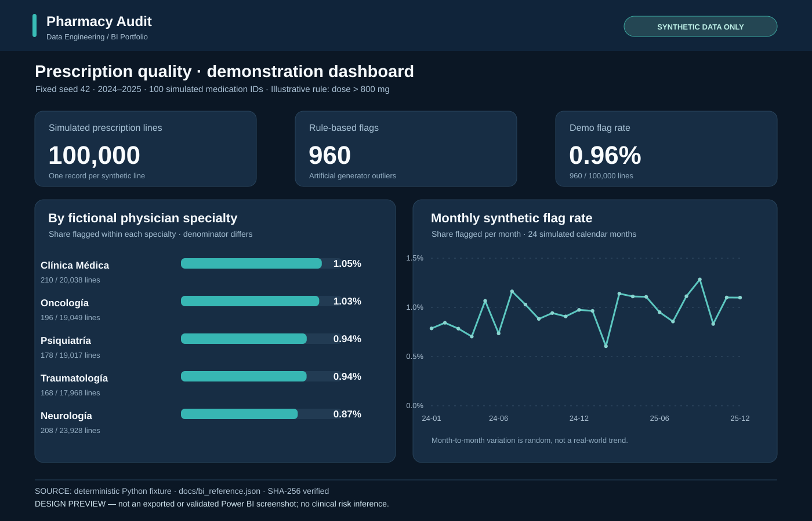

# Power BI — guía de reconstrucción del dashboard

**Objetivo:** convertir la arquitectura SQL comprobable en un dashboard de portfolio, con una identidad visual consistente y métricas trazables.



> **Estado:** la imagen es una **maqueta SVG generada con datos sintéticos verificados**. No representa un archivo PBIX actualizado ni un informe abierto/validado en Power BI Desktop. El archivo histórico [`Auditoria.pbix`](Auditoria.pbix) se conserva sin modificar y su DataModel sigue pendiente de una revisión interna completa. Esta guía explica cómo crear un informe nuevo y comprobable.

## 1. Datos correctos para el modelo

Antes de diseñar gráficos, creá una **base de demostración nueva** y seguí el proceso completo en [README.md](../README.md). PostgreSQL incluye `vw_auditoria_prescripciones`: una fila por **línea de prescripción sintética**, con dosis, fecha, medicamento, especialidad y marca booleana `es_anomalia_demo`.

En Power BI Desktop:

1. **Inicio → Obtener datos → PostgreSQL database**.
2. Seleccioná servidor, base de datos y la vista `vw_auditoria_prescripciones`.
3. Elegí **Importar** para un portfolio reproducible pequeño. Power BI puede solicitar el proveedor Npgsql; instalalo siguiendo su documentación oficial si aparece ese requisito.
4. Definí el campo `fecha_prescripcion` como **Date**, `dosis_mg` como entero y `es_anomalia_demo` como **True/False**.
5. Mantené una tabla de hechos detallada. **No importes solo `vw_auditoria_anomalias`**, ya que elimina las líneas normales y destruye el denominador de los porcentajes.
6. No uses simultáneamente la vista detallada y tablas resumen para calcular las mismas medidas: podría introducir duplicaciones o filtros incompatibles.

La fuente pública openFDA NDC proporciona **metadatos de productos**, no dosis seguras. La inyección de anomalías es artificial y está explicada en [METRICS.md](../docs/METRICS.md).

## 2. Medidas DAX

Creá las medidas de [`medidas.dax`](medidas.dax) en la tabla importada. La lógica es:

- **Total Prescripciones**: cuenta todas las líneas del contexto de medicamento, fecha o especialidad, aun si se aplica un filtro sobre la marca demostrativa.
- **Anomalias Demo**: cuenta las líneas con `es_anomalia_demo = TRUE()` dentro de los mismos filtros descriptivos.
- **Porcentaje Anomalias Demo**: divide la segunda medida por la primera. Formateala como **Percentage, 2 decimal places**. Sin líneas devuelve blanco (`BLANK()`).

Para la evolución mensual, creá una **columna calculada** `Mes` de tipo Date:

```dax
Mes =
    DATE(
        YEAR(vw_auditoria_prescripciones[fecha_prescripcion]),
        MONTH(vw_auditoria_prescripciones[fecha_prescripcion]),
        1
    )
```

Usá `Mes` como fecha continua o con etiqueta mes-año. No agrupes solo por nombre de mes porque mezclaría enero de 2024 y enero de 2025.

**Control de reconciliación:** sin filtros debe mostrar **100.000 líneas, 960 marcas y 0,96 %** solamente si cargaste exactamente el *fixture offline* de 100 medicamentos y semilla 42. La ingesta online del catálogo NDC puede seleccionar otro universo de medicamentos; en ese caso **no** esperes el mismo hash ni las mismas categorías.

## 3. Diseño del informe

Importá el tema [`pharmacy-audit-theme.json`](pharmacy-audit-theme.json) desde **Vista → Temas → Buscar temas**. Utilizá fondo azul oscuro, tipografía Segoe UI/Arial, textos claros, acentos turquesa y etiquetas de valor explícitas. El tema es un punto de partida: definí manualmente fondo de página y contenedores donde Power BI no aplique automáticamente esos colores.

**Página 1 — Overview (16:9):** título “Pharmacy Prescription Audit”; banda permanente “SYNTHETIC DATA ONLY”; tres tarjetas KPI (líneas, marcas demostrativas, porcentaje); barras horizontales ordenadas por tasa de especialidad con recuentos/denominadores en tooltips; gráfico de línea mensual 2024–2025 con tasa en porcentaje y escala temporal; pie con advertencia metodológica.

**Página 2 — Explore:** tabla de detalle con fecha, principio activo, especialidad, dosis y marca; segmentadores de fecha, principio activo y especialidad; gráficos con recuento y tasa por medicamento. Los tooltips deben incluir **numerador y denominador**. Evitá mostrar una “puntuación de riesgo clínico”.

**Accesibilidad y legibilidad:** no dependas exclusivamente del color; etiquetas visibles, contraste elevado, 16:9, orden de tabulación lógico y títulos descriptivos. No agregues fotografías de pacientes ni señales visuales de alerta clínica engañosas.

## 4. Reproducción de la maqueta

La [referencia versionada](../docs/bi_reference.json) se calcula desde el generador Python original:

```bash
python py/03_export_bi_reference.py --output artifacts/bi_reference.json
python -m unittest discover -s tests -v
```

Las agregaciones por mes y especialidad deben sumar **100.000** registros y **960** marcas cada una. El hash esperado del conjunto sintético completo es:

```text
fca80e529a3bc5ac765f5642f10e79c3bfcc169d625705dc7c17257d2c500247
```

En un tablero reconstruido, compará las tres tarjetas y al menos dos segmentos con las salidas SQL. La figura SVG no sustituye esa comprobación.

## 5. Publicación responsable

Antes de publicar un archivo PBIX nuevo, abrilo en Power BI Desktop, comprobá conexiones, Power Query, relaciones, medidas, filtros, cifras, tooltips y accesibilidad. **No reemplaces el archivo histórico ni afirmes que la reconstrucción está validada hasta completar esa revisión.**

No subir credenciales ni datos reales. El modelo comprimido del PBIX histórico no fue inspeccionado íntegramente, por lo que su seguridad para redistribución es **desconocida**. Conservá visibles las advertencias de datos sintéticos y uso no clínico.
